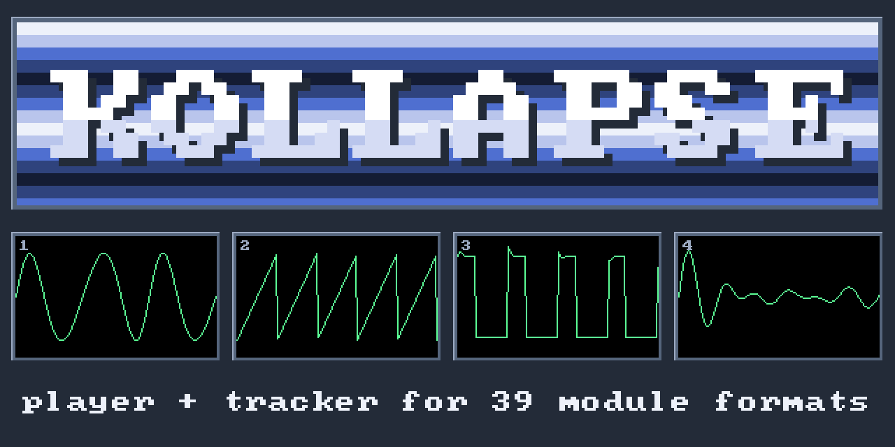
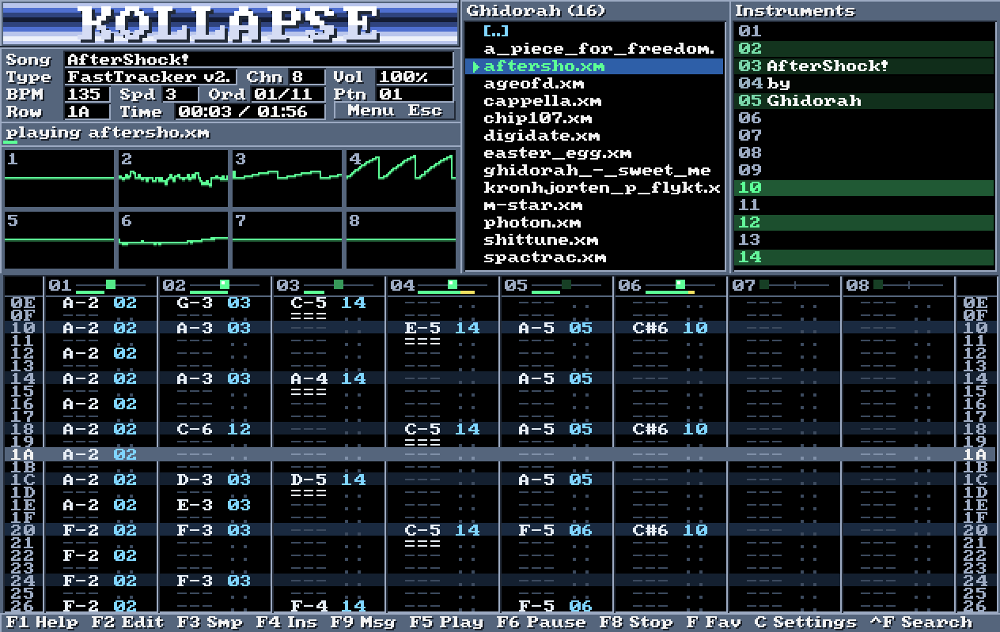
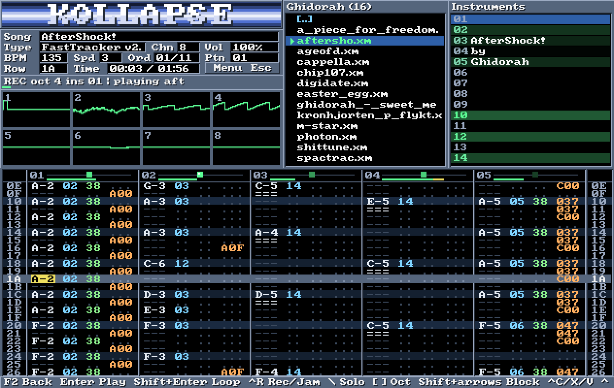
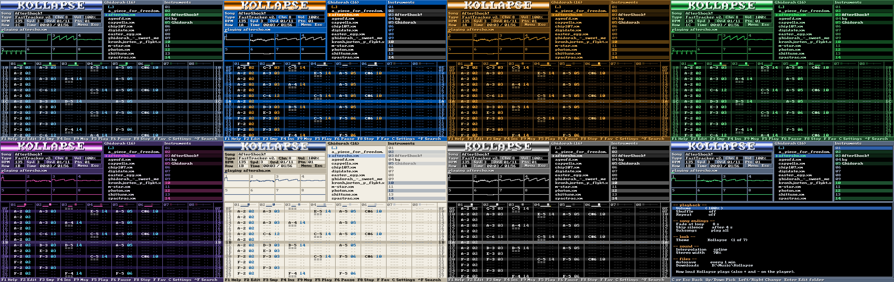

<div align="center">



<br>

<a href="#install"></a>
<a href="#linux"></a>
<a href="#listening"></a>
<a href="#searching-modland"></a>
<a href="LICENSE"></a>

<h3>A tracker module player and editor for the terminal, on Windows and Linux.</h3>

<a href="#listening">Listening</a> · <a href="#searching-modland">Modland</a> · <a href="#composing">Composing</a> · <a href="#settings">Settings</a> · <a href="#install">Install</a> · <a href="#keys">Keys</a> · <a href="#build">Build</a>

</div>

<br>



Kollapse plays tracker modules (MOD, XM, S3M, IT and others) with a layout modelled on FastTracker 2:
per-channel oscilloscopes, panning and level meters, and the pattern data scrolling during playback.
Running `kollapse` in a folder lists the modules in it.

`kollapse` draws in the terminal, using Sixel graphics where the terminal supports them (Windows
Terminal, WezTerm, foot, xterm and others) and block and braille characters elsewhere (`--text` selects
this mode). `kollapsew` shows the same interface in a window (Win32 on Windows, X11 on Linux).

## Listening

Playback uses [libxmp](https://github.com/libxmp/libxmp). Kollapse lists and plays 39 module formats,
including OctaMED, Oktalyzer, DigiBooster, 669, MultiTracker, UltraTracker, Imago Orpheus and the Amiga
packer formats handled by Pro-Wizard.

Song endings:

- Modules that loop fade out over the last 8 seconds before the loop point, then the next track starts.
- Silence at the end of a track is skipped after 4 seconds (not while channels are muted).
- Files with several subsongs play them in order; `[` and `]` switch between them.

Folders, zip archives and `.m3u` playlists can be browsed. Shuffle, repeat and a favorites list are
available, and media keys work while the window is in the background. Clicking a channel's scope mutes
it; right-clicking solos it.

## Searching Modland

`Ctrl+F` searches [Modland](https://ftp.modland.com/). Kollapse downloads Modland's public file index
once (about 6 MB) and searches it locally; the search itself sends nothing over the network. The index
contains about 176,000 modules in supported formats.

Pressing Enter on a result downloads the module to `Music\Kollapse\<artist>` and plays it. No account
or API key is required.

## Composing



`F2` opens the pattern editor. Notes are entered with the FT2 piano layout, and notes struck together
are placed in adjacent channels. During playback, entered notes go to the row being played. `Ctrl+R`
switches to jam mode, in which keys play notes without recording them.

The editor also provides:

- block copy, cut, paste, transpose and interpolate, with undo for all edits
- sample editing: loop points, cut, trim, reverse, normalize, WAV import
- volume and panning envelopes, keymaps, auto-vibrato
- a song page for the order list, pattern length, channel count, BPM and speed

`Ctrl+S` saves the song as `<name>-kollapse.xm` next to the original file, which is never overwritten.
`Ctrl+E` exports a WAV file. Unsaved changes are autosaved every minute.

## Settings



`C` opens the settings page. It covers the colour theme (Kollapse, Amiga, Amber, Phosphor, Midnight,
Paper, Mono), fade length, silence skip, interpolation, stereo width, autosave interval and the download
folder. Settings are stored in `%APPDATA%\kollapse.ini`.

## Install

Download `Kollapse-Windows.zip` from the [latest release](https://github.com/BaxterWolf/Kollapse/releases/latest)
(or build from source, see below), unzip it, and run in the folder containing the `.exe` files:

```
powershell -ExecutionPolicy Bypass -File install.ps1
```

The script copies `kollapse.exe` and `kollapsew.exe` to `%LOCALAPPDATA%\Programs\kollapse` and adds
that folder to the user PATH.

The release isn't code-signed, so Windows may say it protected your PC the first time you start it.
Click **More info**, then **Run anyway**.

### Verifying a download

Releases are built by GitHub Actions from the tagged source, not on anyone's PC. Each release lists
the SHA-256 hash of its zip, and GitHub records where the zip was built. To check that a download
came from this repository's workflow, use the [GitHub CLI](https://cli.github.com):

```
gh attestation verify Kollapse-Windows.zip --repo BaxterWolf/Kollapse
```

Usage:

```
kollapse              the tracks in this folder
kollapse <folder>     the tracks in that folder
kollapse song.xm      play one track
kollapse pack.zip     open a zip of modules
kollapse -l           go back to the last folder
kollapse --text       text characters instead of pixel graphics
kollapse --version    which version this is
```

### Linux

There are no Linux releases yet; build from source. `kollapse` is the terminal player and `kollapsew` the window version (X11, so it also runs under
XWayland). Media keys work over MPRIS, so desktop media keys, panel players and `playerctl` control
Kollapse. Audio goes through PulseAudio, PipeWire or ALSA, whichever is running. Modland downloads use
the `curl` program.

The window version needs `libx11-dev` and media keys need `libdbus-1-dev` (package names on Debian and
Ubuntu). Without them `make` builds the terminal player alone, without media keys.

```
sudo apt install libx11-dev libdbus-1-dev
make
make install          copies kollapse and kollapsew to ~/.local/bin
```

Settings, favorites and the Modland index live in `~/.config/kollapse/`.

## Keys

The function keys follow Schism Tracker. `F1` lists all keys; the most common are:

| Key | |
|---|---|
| `Enter` | play the selected track, open a folder |
| `F5` / `F6` or `Space` / `F8` | play, pause, stop |
| `N` / `P` | next, previous track |
| `S` / `R` | shuffle, repeat (off, track, all) |
| `F` / `Shift+F` | star a track, open favorites |
| `[` / `]` | previous, next subsong |
| `Ctrl+F` | search Modland |
| `C` | settings |
| `F2` / `F3` / `F4` | pattern editor, samples, instruments |
| `F9` / `F10` | song message, song page |
| `Esc` | menu |
| `Ctrl+Q` | quit |

## Build

Windows: MinGW GCC and `mingw32-make` (tested with 32-bit MinGW GCC 6.3). Linux: GCC and `make` (tested
with GCC 15 on Ubuntu 26.04), plus the optional X11 and D-Bus headers above. libxmp, miniz and miniaudio
are included in `third_party/`.

```
mingw32-make                 kollapse.exe and kollapsew.exe
make                         Linux: kollapse and kollapsew
```

## Credits

- [libxmp](https://github.com/libxmp/libxmp) 4.7.4 by Claudio Matsuoka, Hipolito Carraro Jr and
  contributors (MIT), including Pro-Wizard by Sylvain "Asle" Chipaux
- [miniz](https://github.com/richgel999/miniz) 3.1.2 (MIT)
- [miniaudio](https://github.com/mackron/miniaudio) 0.11.21 by David Reid (public domain or MIT-0), Linux audio
- font8x8 by Daniel Hepper (public domain)
- layout reference: 8bitbubsy's [ft2-clone](https://github.com/8bitbubsy/ft2-clone)
- module search: Modland's public file index; all music remains the work of its authors

## License

[GPL-3.0](LICENSE). Use it, change it, share it. If you distribute a modified version, its source has to
stay open under the same license. The libraries in `third_party/` keep their own licenses (MIT for libxmp
and miniz, public domain or MIT-0 for miniaudio, public domain for font8x8).
